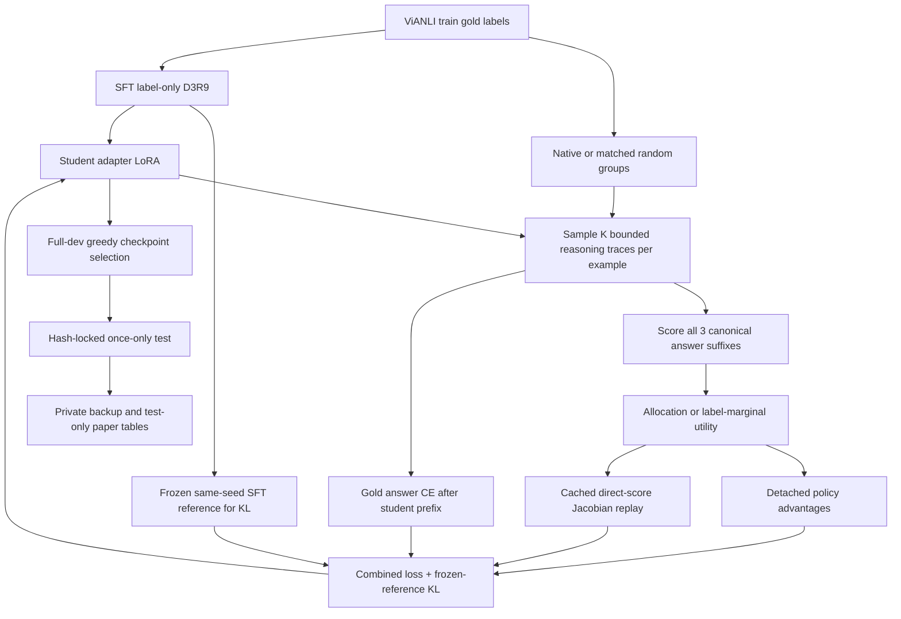

# Framework và logic phương pháp

## Luồng tổng thể

Không có encoder/hybrid hay external teacher trong framework hiện tại. Bài hybrid do người dùng cung cấp là công trình trước làm bối cảnh, không phải architecture của code nativeRL.

## SFT và model

- D3/D3R3/D3R9: gold-only label SFT. D3R9 dùng shared `sft_schedule=full_budget` để không early-stop theo proxy metric cũ; warm adapter được dùng ở checkpoint600.
- Tokenization SFT dùng cùng non-thinking chat prefix với eval; labels của prompt bị mask -100; completion `<answer>gold</answer>` +EOS. Không truncate lặng lẽ làm mất target.
- Model thực tế được loader nạp BF16 + LoRA; **không tự mô tả là NF4 QLoRA** chỉ vì spec/paper cũ có ghi như vậy. Native adapter rank32/alpha64; source và environment snapshot của từng run mới là chuẩn cuối.
- Native RL tắt dropout toàn bộ theo config, giữ reference adapter `ref` frozen, xác minh identical fingerprint trước train và unchanged sau train.
- Pinned model revision dùng trong evaluator sau: `15852e8c16360a2fea060d615a32b45270f8a8fc`.

## Grouping và rollout

`train/native_groups.py` chia theo premise chuẩn hóa thành block1–3 examples; padding slot có weight0. Random control giữ chính xác row exposure và gold label-slot templates trong mỗi lịch update, đồng thời tách premise trong block. Gold không được đưa vào prompt.

`train/native_rollout.py` tạo `<think>reasoning</think><answer>label</answer>` có ngân sách cứng. Full profile: K4,8groups/update, reasoning128tokens, tổng160; temperature1/top_p1. Các delimiter bị ép/chèn không nhận policy credit như token tự sample. Ở label-marginal mode, sampled answer cũng bị mask **trước** TRL tính KL/importance ratios.

Native train format có thể là CoT trong khi evaluation format là label. Điều này là cấu hình có chủ đích từ N12R15, không được nhầm `format=label` là RL không sample reasoning. Đây cũng là hạn chế khi diễn giải tác dụng của reasoning.

## Canonical answer scores

Với example i, trace z và class c, score `s(i,z,c)` là tổng log-prob của suffix canonical `c</answer>` +EOS sau student prefix. Ba score dùng cùng geometry/fixed padding. Đây là score của cả chuỗi suffix, không phải riêng một token class.

### Conditional native label allocation

Gọi y là gold labels trong block G, Ω(y) là các hoán vị **khác nhau của gold multiset đã quan sát**:

`log Q_G = sum_i s(i,z_i,y_i) - logsumexp_{a in Ω(y)} sum_i s(i,z_i,a_i)`.

- Không ép mỗi block phải có đủ ba nhãn. Repeated labels được giữ; singleton/same-label block trả contrast0.
- Đây là phân phối assignment có điều kiện trên multiset, không phải xác suất correctness độc lập từng example.
- Row offsets và shared class-score offsets triệt tiêu vì mọi assignment có cùng multiset. Điều này không xóa mọi hypothesis-specific shortcut và không bảo đảm absolute classification calibration.
- Direct objective thường là `-logQ`. `allocation_linearization` cache giá trị và Jacobian theo score đã detach; `allocation_surrogate` tái tạo gradient cục bộ qua microbatches mà không giữ toàn bộ model graph. Exact ở cached point cho score derivative, không phải exact optimizer continuation/higher-order objective.

### Các policy reward variants

Base native CoT reward ở branch hiện tại: correctness +0.2*format; alignment structural reward thuộc hướng legacy, không tự chuyển công thức đó vào native method.

| native_mode | Policy shaping / direct channel |
|---|---|
| ordinary | Ordinary correctness/format GRPO, answer CE; không direct allocation |
| native / random | Group logQ reward với grouping tương ứng; kiểm tra đúng config historical |
| allocation | Direct allocation + answer CE; policy không nhận thêm logQ shaping |
| joint | Group logQ shaping + direct allocation + answer CE |
| saliency | Allocation setup + token weights từ gradient-activation |
| trace_swap | Policy dùng logQown-logQswap; vẫn direct allocation trên own traces |
| trace_saliency | Trace swap policy + saliency của **own allocation**, không phải attribution của toàn reward contrast |
| gated_joint | `Rbase +0.2*correct*Qown` ở informative group; direct allocation vẫn có |
| gated_trace_swap | `Rbase +0.2*correct*(Qown-Qswap)`; direct allocation không bị gate |
| allocation_only | Policy/KL loss coefficient0; vẫn answer CE + direct allocation — **đối chứng không RL** |
| marginal_accuracy / marginal_f1 | Label-marginal utility, RLOO reasoning advantages + direct utility gradient + answer CE |
| ce | Policy coefficient0; đọc source historical để xác định các auxiliary còn lại |

Với bounded swap bonus, bonus nằm[-0.2,0.2] và raw correctness ordering được giữ. Không suy ra bound cho normalized advantages hay total gradients. Wrong completion có thể nhận ảnh hưởng từ gold-answer CE/direct term theo thiết kế; phải phân biệt với scalar wrong-positive policy credit.

### Trace swap

`native_swap_indices` xoay reasoning prefixes giữa các active slots cùng group và rollout bằng quy tắc label-blind. Prompt của example giữ nguyên, chỉ donor prefix đổi. Identical prefix tái sử dụng score để contrast bằng0. Đây là kiểm tra context specificity của trace, không chứng minh causal faithfulness. N13R16 so với N12R15 đổi cả gate/transform/range nên không phải ablation một yếu tố.

### Token saliency

Source lấy gradient của direct own-allocation objective theo input embedding, nhân activation; cộng vector theo ba class **trước** lấy magnitude. Mỗi reasoning span chuẩn hóa mean weight1 với floor0.25. Detached weights nhân scalar advantage trên reasoning token; answer credit được giữ. Độ lớn gradient là local sensitivity, không có dấu semantic good/bad và không phải chứng cứ lời giải đúng.

### Label-marginal finite-label utility

`q(i,k)=softmax(s(i,k,:))`. Với mỗi rollout k, sample class của **các example khác** từ detached q và ghi seed. Bỏ example i khỏi confusion matrix `C_-i,k`, rồi:

`U(i,k,c)=B*[MF1(C_-i,k + e(gold_i,c)) - MF1(C_-i,k)]`.

`r(i,k)=sum_c q(i,k,c)*U(i,k,c)`, direct loss `-r`. Accuracy control dùng `U(c)=1[c=gold]`. Policy advantage là leave-one-out giữa K reasoning samples của cùng example, không chia standard deviation.

Utility của candidate không dùng chính sampled answer của nó. Đây là minibatch conditional utility với randomness từ các row khác, **không phải exact expected corpus Macro-F1**, cũng không bảo đảm greedy inference tốt hơn. Canonical constrained q khác greedy generative eval. Native blocks chỉ giữ exposure trong mode này; assignment constraint không được tối ưu.

## Combined loss và gradient audit

Thông thường: `L = policy_coefficient*L_TRL(policy,KL_ref) +0.1*L_answerCE +0.2*L_direct` với LR2e-6/KLbeta0.01. Đọc frozen config từng run vì profile/budget khác theo cohort.

Cached/live score width phải giữ bằng nhau cả original/swapped/saliency paths; inactive padding có reward/Jacobian/mask0 trước mọi arithmetic. Smoke yêu cầu finite nonzero gradient từng channel mong đợi, zero active replay drift, dropout0, frozen reference unchanged. Kiểm tra tensor advantage trong TRL1.15 thực tế cho thấy chỉ unsqueeze khi dim1; không có lỗi unconditional broadcast như từng nghi ngờ.

## Legacy alignment/GTA

Parser hỗ trợ label/cot/align và optional `<guess>`. Alignment gồm1–6 H-span↔P-span lines, match/missing/conflict; missing đi cùng∅. Rule: conflict→contradiction, else missing→neutral, elseentailment. Structural reward yêu cầu quoted substrings sau NFC/whitespace/casefold, H coverage≥0.5 và rule đúng answer. GTA supervise guess, mask guess khỏi RL và xử lý gradient conflict. Các hướng này đã có code/early experiments nhưng không phải phương pháp mới đã đạt mục tiêu. `build_sft_dataset` cho cot/align vẫn có legacy teacher-file dependency: không chạy nhánh đó trong giới hạn hiện tại.
